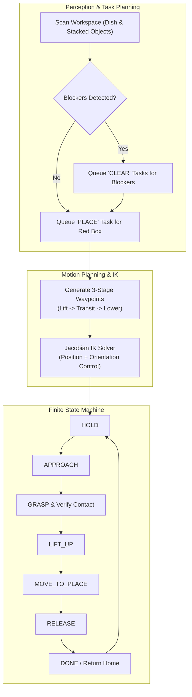

# Franka Emika Panda Autonomous Pick-and-Place (TAMP in MuJoCo)

An autonomous robotic manipulation pipeline built in **Python** and **MuJoCo**, implementing **Task and Motion Planning (TAMP)** with numerical inverse kinematics, obstacle clearing, and finite state machine (FSM) control on a 7-DOF **Franka Emika Panda** manipulator with a parallel-jaw gripper.

---

## Overview

The core objective of this project is autonomous clearing and manipulation: the robotic arm scans the workspace, detects blocking obstacles, dynamically plans clearing operations to safe drop zones, and relocates the target object (**red box**) into a designated destination (**dish**).

---

## Demonstration

<div align="center">
  <video src="assets/Arm.mp4" width="100%" controls autoplay loop muted>
    <p>Your browser does not support the video tag. View the demo directly: <a href="assets/Arm.mp4">assets/Arm.mp4</a></p>
  </video>
</div>

---

## Pipeline Architecture



---

## Key Features

* **Task and Motion Planning (TAMP):**
  * **Dynamic Obstacle Detection:** Identifies obstacles obstructing the target dish ($< 0.15\text{ m}$) or stacked directly atop the target object (`is_on_top`).
  * **FIFO Task Queue:** Dynamically queues `CLEAR` operations for obstacle boxes (`green_box1`, `green_box2`, `green_box3`) before executing the final `PLACE` task.
  * **Safe Drop Generation:** Computes randomized safe clearing positions on the table away from the workspace center.

* **3-Stage Waypoint Motion Planner:**
  * Generates collision-aware 3D trajectories:
    1. **Vertical Lift:** Lifts end-effector straight up ($+Z$) to avoid lateral collisions or dragging.
    2. **Horizontal Transit:** Travels at safe clearance altitude to the target $(X, Y)$ coordinate.
    3. **Controlled Descent:** Lowers end-effector to grasping or placement height.
  * Live visual waypoint markers (`wp1`, `wp2`, `wp3`) updated in the MuJoCo viewer in real time.

* **Jacobian Inverse Kinematics (IK):**
  * Numerical Jacobian control computed via `mujoco.mj_jacSite`:
    $$\mathbf{J} = \begin{bmatrix} \mathbf{J}_p \\ \mathbf{J}_r \end{bmatrix} \in \mathbb{R}^{6 \times 7}$$
  * Full 6-DOF tracking (position error $\mathbf{e}_p \in \mathbb{R}^3$ and orientation rotation-vector error $\mathbf{e}_r \in \mathbb{R}^3$).
  * Dynamic error clipping ($\pm 0.05\text{ m/rad}$) and singularity / rank-deficiency detection ($\operatorname{rank}(\mathbf{J}) < 6$).
  * Coriolis and gravity compensation applied to arm joints:
    $$\boldsymbol{\tau}_{\text{applied}} = \boldsymbol{\tau}_{\text{bias}}$$

* **Robust Grasp Verification & Physics Settling:**
  * Double-contact grasp verification (`is_grasped`): checks simulation contact pairs to ensure both `left_finger` and `right_finger` maintain contact with the object before lifting.
  * Settling counters (`WAIT_AFTER_GRASP`, `WAIT_AFTER_RELEASE`, `WAIT_AFTER_DONE`) to prevent dynamic slips during rapid transitions.

---

## State Machine & Execution Flow

The high-level controller ([controller_3.py](file:///home/wizard/workspaces/mujoco_ws/ARM_Project/controller_3.py)) runs a synchronous state machine at $500\text{ Hz}$ ($dt = 0.002\text{ s}$):

| State | Description | Next State Condition |
| :--- | :--- | :--- |
| **`HOLD`** | Scans environment, constructs `task_queue`, and initializes motion plan | Task popped and plan generated $\to$ `APPROACH` |
| **`APPROACH`** | Traverses waypoints toward object grasping pose | Final waypoint reached $\to$ `GRASP` |
| **`GRASP`** | Closes parallel gripper (`ctrl[7:] = 0.0`) | Both fingers contact object $\to$ `LIFT_UP` |
| **`LIFT_UP`** | Lifts object vertically to hover altitude, then plans path to destination | Altitude threshold reached and plan ready $\to$ `MOVE_TO_PLACE` |
| **`MOVE_TO_PLACE`** | Follows waypoint trajectory to clearing zone or dish | Destination waypoint reached $\to$ `RELEASE` |
| **`RELEASE`** | Opens gripper (`ctrl[7:] = 255.0`) and holds position for release delay | Release wait counter expires $\to$ `DONE` |
| **`DONE`** | Returns end-effector to home configuration | Ready for next task $\to$ `HOLD` (or `EXIT` if finished) |
| **`EXIT`** | Cleanly terminates simulation loop upon completing all tasks | Simulation exit |

---

## Project Structure

```text
ARM_Project/
├── assets/                  # 3D meshes (.stl, .obj) and demo video (Arm.mp4)
├── include/                 # Core control and planning modules
│   ├── config_3.py          # Hyperparameters, thresholds, and joint configurations
│   ├── IK_3.py              # Jacobian IK engine and orientation error calculation
│   ├── motion_planner_3.py  # 3-stage waypoint trajectory planner
│   └── utils_3.py           # Grasp verification, obstacle detection, and marker updates
├── controller_3.py          # Main TAMP state machine and MuJoCo simulation loop
├── panda.xml                # Franka Emika Panda MJCF robot definition
├── scene_3.xml              # World environment, table, obstacles, target, and cameras
├── requirement.txt          # Python dependencies
├── run.sh                   # Environment activation and execution script
├── Description.pdf          # Detailed project specification document
└── .gitignore               # Git exclusions for Python, caches, and simulation files
```

---

## Installation & Setup

### Prerequisites

* Linux / macOS / Windows with Python 3.10+
* MuJoCo 3.0+

### 1. Clone & Setup Virtual Environment

```bash
cd ARM_Project

# Create virtual environment
python3 -m venv myenv

# Activate virtual environment
source myenv/bin/activate
```

### 2. Install Dependencies

```bash
pip install -r requirement.txt
```

*(Dependencies: `mujoco`, `scipy`, `numpy`)*

---

## Running the Simulation

Execute the launch script directly from the project directory:

```bash
./run.sh
```

Or execute directly with Python:

```bash
python3 controller_3.py
```

### Simulation Controls & Visualizer

* **Mouse Navigation:**
  * **Left Click + Drag:** Rotate viewpoint
  * **Right Click + Drag:** Translate / Pan
  * **Scroll Wheel:** Zoom in / out
* **Waypoint Markers:**
  * Yellow/amber spherical sites (`wp1`, `wp2`, `wp3`) dynamically render in the scene to illustrate the active trajectory path.

---

## Configuration & Tuning

Key parameters can be adjusted in [include/config_3.py](file:///home/wizard/workspaces/mujoco_ws/ARM_Project/include/config_3.py):

| Parameter | Default Value | Description |
| :--- | :--- | :--- |
| `STEP_SIZE_FAST` | `0.05` | IK integration step size during approach and transit |
| `STEP_SIZE_SLOW` | `0.03` | Fine integration step size for descent / precision placing |
| `HOVER_DISTANCE` | `0.10 m` | Clearance altitude above obstacles during transit |
| `LIFT_HEIGHT` | `0.10 m` | Vertical lift height for waypoint stage 1 |
| `START_DELAY` | `3.0 s` | Initial settling delay before task execution begins |
| `WAIT_AFTER_GRASP` | `20 steps` | Settling period after gripper closes |
| `WAIT_AFTER_RELEASE` | `50 steps` | Settling period after gripper opens |
| `obstacles` | `["red_box", "green_box1", ...]` | List of scene object identifiers tracked by perception |
